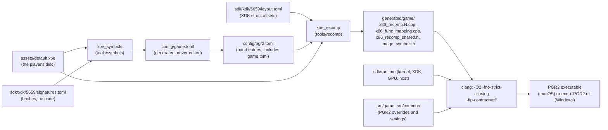

# Part 1: the static recompilation

How an original Xbox executable (an XBE) becomes C++ that builds into a native program, stage by stage. Everything
here runs at build time, before the game starts. Part 2 covers what the generated code calls into at run time.

Sources read: `sdk/tools/recomp/*`, `sdk/tools/symbols/main.cpp`, `sdk/runtime/xbe/xbe.h`,
`sdk/runtime/cpu/{x86_context.h,x86_ops.h,sse_approx.h,dispatch.cpp}`, `sdk/cmake/XbeRecomp.cmake`, `CMakeLists.txt`,
`config/*.toml`, `sdk/xdk/5659/*.toml`, `src/game/hooks.cpp`, `CLAUDE.md`, `FINDINGS.md`.

## 1.1 The pipeline at a glance



The idea, in one paragraph: the XBE's x86 code is decoded once, ahead of time, and each guest function becomes one
C++ function that manipulates an `X86Context` (the guest registers) and a flat 4 GB block of guest memory. The Xbox
kernel and the Microsoft XDK libraries the game linked in (Direct3D 8, DirectSound, XAPI, XNet) are not
recompiled where it matters: they are found by signature and replaced with host implementations ("HLE",
high-level emulation at the API level). The game's own code runs as recompiled C++; at the API boundary it calls
host code instead of the console's hardware.

## 1.2 Reading the XBE (`sdk/runtime/xbe/xbe.h`)

An XBE is the Xbox's executable format. `xbe::Image::Parse` reads:

- The image header: base address, image size, the **entry point** and **kernel thunk table** address. Both are
  XORed with fixed retail/debug keys in the header (`xbe.h`, "the header XORs the entry point and kernel thunk
  address with these").
- The **section headers** (`.text`, `D3D`, `DSOUND`, `XNET`, ...), each with a virtual address and file range. The
  config lists which are code (`code_sections` in `config/game.toml`).
- The **library versions** (major/minor/build/flags per linked XDK library). PGR2 links XDK 1.0.5659 throughout
  (FINDINGS.md, "The image").
- The **certificate**, whose +8 is the title id (PGR2: `0x4D53004B`).

The kernel thunk table is a list of ordinals into `xboxkrnl.exe` exports. The recompiler recognises
`call [thunk + n]` and emits a direct call to the host kernel export by ordinal (`x86_kernel(ctx, base, ordinal)`,
`codegen.cpp` `EmitInsn`).

PGR2-specific facts (FINDINGS.md): the PAL and NTSC `default.xbe` differ only in the signature and certificate, so
every address in this project holds for both; "media patched" copies differ in one byte inside XAPI start-up code that
the host replaces anyway.

## 1.3 Finding the XDK library functions (`xbe_symbols`, `sdk/xdk/*/signatures.toml`)

The host must know where in this particular XBE each XDK function lives (say `D3DDevice_SetTexture` or
`IDirectSoundBuffer_Play`) so it can replace it. Games are statically linked, so there are no import names. The SDK's
`xbe_symbols` tool (`sdk/tools/symbols/main.cpp`) finds them by **signature**:

- `signatures.toml` (per XDK build: 3925, 3948, 4039, 4831, 5659, 5849) holds, for each named function, a hash of its
  first `len` bytes with image addresses and rel32 targets masked, the hashes of the functions it calls (two levels
  deep when lookalikes exist), its sorted constants (`k`), the bytes its `ret` pops and the registers it reads first.
  It never stores library bytes (a project rule: `CLAUDE.md`). The file's header comment documents every field.
- The scan hashes every candidate in the XBE's library sections with the same masking and matches. When the bytes do
  not match, a match "by constants" is attempted with a score and a required lead over rivals; `ret` and `regs` then
  reveal a changed calling convention.
- Data symbols (globals such as the D3D device pointer) are found through an anchor function, an instruction index
  and an operand.
- **LTCG**: libraries built with link-time code generation may pass arguments in registers. The scan writes an
  `[abi]` map (or `"?"` where unproven); `xbe_recomp` refuses to run with an unproven map (`main.cpp`), and the hand
  config must give the locations.

Output: `config/game.toml`, completely rewritten every scan: `[xbe]` (path, title, entry, `xdk = 5659`,
`out = "generated/game"`, `partitions = 64`, `code_sections`), `[symbols]` (name to address, 0 when absent) and
`[data]`. A function the scan cannot find stays 0 and becomes a **trapping stub**: if the game ever calls it, it
traps with a clear message, and the fix is to find it by hand in Ghidra, add it, then re-sign:
`xbe_symbols --sign config/pgr2.toml --out sdk/xdk/5659/signatures.toml` (CLAUDE.md, "Config"). For 5659: 191 of 250
functions and 13 of 13 data items (FINDINGS.md). The ones found by hand when PGR2 hit them include Reset,
SetDepthClipPlanes, SetRenderTargetFast, SetVertexShaderInput(Direct), PresentInterval, XapiVerifyMediaInDrive,
PlayEx/Pause, SetDopplerFactor, XNetGetConnectStatus, XNetUnregisterInAddr.

`sdk/xdk/5659/layout.toml` is the other half: offsets inside XDK structures the host reads or writes (the D3D
`CDevice` fields such as the push pointer at +0x0, `ZScale` at +0x944, the swap count at +0x2468). Every value cites
the PGR2 instruction that proves it. `[xbe] xdk = 5659` makes the recompiler include it, and its entries reach the
runtime as `XDK_<name>` constants in `image_symbols.h`.

## 1.4 The two configs

| File | Written by | Holds |
| --- | --- | --- |
| `config/game.toml` | `xbe_symbols` only | `[xbe]` image facts and code sections, `[symbols]`, `[data]`, `[functions]` (empty) |
| `config/pgr2.toml` | by hand | `includes = ["game.toml"]`, then hand entries; this is the file the build reads |

Hand entry kinds the recompiler accepts (`tools/recomp/main.cpp`, `LoadConfig`'s header comment):

- `[functions]` address = name: extra entry points the analysis missed (an indirect call to an unknown address traps at
  run time and the log says exactly this: "add 0x... to [functions]", `cpu/dispatch.cpp`).
- `[[hook]]` at, call, after, on_true/on_false: call a host function before or after any one guest instruction; with
  `on_true`/`on_false` it returns bool and can `ret` or jump inside the function.
- `[[function]]` at, end: force an entry and limit its decode.
- `[[switch]]` at, targets: give an indirect `jmp`'s targets when table detection fails.
- `[xbe] data_ranges`: bytes inside code sections that are data, so the analysis does not decode them.
- `[xbe] trace`: log every call of a function with its caller, arguments and result.
- `[abi]`: argument locations for LTCG library functions.

What PGR2 actually uses today is small: `library = "PGR2.dll"` (the Windows game code DLL name) and two
`[functions]` entries, `0x1EDE60` (`CDirectSoundStream_Constructor`, an anchor for signing) and `0x7F9F0` (a menu
callback a guessed decode overlapped; it trapped when the Paris DLC menu called it, PROGRESS 2026-10-24). There are no
`[[hook]]` entries: every PGR2 change is a whole-function override (section 1.8).

## 1.5 The recompiler: analysis (`tools/recomp/analysis.cpp`)

`Analysis::Run` decides which bytes are code and where functions start:

1. **Direct discovery.** A work queue starts at the entry point plus every `[functions]` and `[symbols]` address.
   `Walk` decodes each function with Zydis (32-bit legacy mode), following straight-line code, conditional and
   direct jumps, and queues direct call targets. Each decoded instruction is stored as an `Insn` (length, a `Flow`
   kind: Normal, Jcc, Jmp, JmpIndirect, Call, CallIndirect, Ret, Stop, Invalid, and a branch target).
2. **Jump tables.** An indirect `jmp [table + reg*4]` has its table read (`ReadTable`); the forms MSVC emits are
   handled, including byte-indexed and backwards tables and the "copy sled" at the end of MSVC's `memcpy`
   (`SledTable`: "and r, mask; neg r; add r, end; jmp r" into a run of `movsd`).
3. **Pointer seeds** (`SeedPointers`): data dwords that point at plausible function starts become candidates.
4. **Gap fill** (`GapFill`): the space between known functions is decoded as untrusted entries, accepted only when
   they follow padding, a return or an unconditional jump (`PlausibleEntry`).
5. **Immediates that point at code** (`push imm` / `mov reg, imm` of a code address) are callbacks and become
   entries.
6. **C++ exception continuations** (`EhContinuations`): MSVC's `__CxxFrameHandler` thunks are parsed so catch blocks
   and unwind funclets become entries, and the addresses where a catch resumes are recorded.

`CheckOverrides` then rejects config mistakes (a `[[function]]` that is not decodable, a `[[switch]]` that is not an
indirect jump). A function's **body** is every instruction reachable from its entry without entering another entry
(`Analysis::Body`); a shared tail reached by a jump may sit below the entry, which the generator handles with a
`goto` at the top.

## 1.6 The recompiler: code generation (`codegen*.cpp`)

### The guest CPU state

`sdk/runtime/cpu/x86_context.h`:

```cpp
struct alignas(64) X86Context {
    uint32_t eax, ecx, edx, ebx, esp, ebp, esi, edi;
    uint32_t cf, zf, sf, of, pf;   // only live across tail calls; functions keep flags in locals
    uint32_t df, xflags, fs_base;
    uint32_t top;                  // x87 stack top
    uint16_t fcw, fsw; uint32_t mxcsr;
    double st[8]; uint64_t mm[8]; X86Xmm xmm[8];
    uint32_t thread_handle, last_icall; void* host;
};
using X86Func = void(X86Context& ctx, uint8_t* base);
```

Every recompiled function has the signature `X86Func`: the context and `base`, the host pointer to guest address 0.
Guest memory is accessed through macros in `x86_ops.h`: `X86_MEM32(a)` is `*(uint32_t*)(base + (uint32_t)a)` with an
unaligned, `may_alias` type. There are no bounds checks; guest addresses are 32-bit and the host reserves the whole 4
GB (part 2, section 2.1).

### One guest function becomes one C++ function

`CodeGen::EmitFunction` writes, for entry `0x00012345`:

```cpp
X86_FUNC(__imp__sub_00012345) {
    X86_LOAD_FLAGS();            // cf, zf, sf, of, pf as locals
    uint32_t ca = 0, cb = 0;     // the last cmp/test operands
loc_00012350:
    // 00012350 mov eax, [ecx+0x10]
    ctx.eax = (uint32_t)(X86_MEM32((uint32_t)(ctx.ecx + 0x10u)));
    ...
}
X86_WEAK_FUNC(sub_00012345, __imp__sub_00012345)
```

Key translation rules (`codegen.cpp` `EmitInsn`, `codegen_int.cpp`, `codegen_fp.cpp`):

- **Registers** are fields of `ctx`; 8 and 16-bit sub-registers are masked reads and read-modify-writes.
- **Control flow.** A jump inside the body is a `goto loc_X`. A jump to another function is a tail call:
  `{ X86_SAVE_FLAGS(); sub_X(ctx, base); return; }`. A **call** pushes the return address onto the *guest* stack
  (`X86_PUSH32(next)`) and calls the C++ function; the callee's `ret` does `ctx.esp += 4 + n; return;`. So the guest
  stack is real guest memory, while the host stack nests one frame per guest call (guest threads get 64 MB host
  stacks for this, `kernel/threads.cpp` `Spawn`).
- **Indirect calls and jumps** go through `x86_icall(ctx, base, target)` (`cpu/dispatch.cpp`), which looks the target
  up in a table built from `X86FuncMappings[]` (guest address to host function), and also handles kernel thunk
  addresses, host thunks (host functions the guest may call through a pointer, at `0xFD000000+`), and catch
  continuations. An unknown target traps with "add 0x... to [functions]".
- **Jump tables** become a C++ `switch` over the target with a default of `x86_icall`.
- **Flags.** Flags are local variables; they are only stored in `ctx` around calls and tail calls. A peephole keeps the
  operands of the last `cmp`/`test` (`ca`, `cb`) and turns the following `jcc`/`setcc`/`cmovcc` into a direct C
  comparison (`CodeGen::Cond`: `jb` after `cmp` is `(uint32_t)ca < (uint32_t)cb`), so most flag computation
  disappears. Other instructions compute the flags they set.
- **Spin loops.** Every backward jump gets `X86_BARRIER()` (a compiler memory barrier), so a loop polling memory
  another thread writes re-reads it.
- **Kernel calls** through the thunk table become `x86_kernel(ctx, base, ordinal)`.
- **C++ exceptions.** A function that installs an SEH frame (`mov fs:[0], ...`) is wrapped in
  `try { ... } catch (const X86Resume& r)`. When the CRT jumps to a catch continuation, `x86_icall` throws
  `X86Resume{target, esp}`, which unwinds the host stack to the frame that owns that guest stack depth, and
  `x86_resume` continues there.
- **Unimplemented instructions** emit `x86_trap(ctx, va, "unimplemented: ...")` and are counted, so a build reports
  what is missing rather than silently miscompiling.
- **Hooks** (`EmitHooks`) wrap a guest instruction with calls to a host function, saving and reloading flags around
  it.
- **Traced functions** (`[xbe] trace`) are wrapped in `X86_TRACED_FUNC`, which logs arguments and `eax`.

### x87, SSE and MMX

- **x87** (`codegen_fp.cpp`, helpers in `x86_ops.h`): the eight-register stack is `ctx.st[8]` (host `double`) with a
  runtime `ctx.top`, so `X87_ST(i)` is `ctx.st[(ctx.top + i) & 7]`. Precision control is honoured: when the control
  word asks for 24 bits, results are rounded through `float` (`x87_prec`). Rounding mode (`x87_round`), compare
  results into C0/C2/C3 (`x87_compare`), integer conversion with the "integer indefinite" value on overflow
  (`x87_to_i32`) follow the FPU. A known gap: the console's x87 keeps 64-bit mantissas internally while this uses
  host doubles, and transcendental instructions (FSIN, FCOS, FPATAN, F2XM1) use the host's double results
  (PROGRESS 2026-11-09, "Not settled").
- **SSE** operates on `ctx.xmm[i]` as a union of `float[4]`/`uint32_t[4]`/`uint64_t[2]`.
- **RSQRTSS/RSQRTPS and RCPSS/RCPPS: `sse_approx.h`.** Intel processors, the Xbox's Pentium III included, answer these
  with ~12-bit approximations from an internal table, not exact results. Games then refine with one Newton step. The
  recompiler used to emit exact `1.0f / std::sqrt(x)`, which changes the last bits of every refined result. PGR2's
  replays and demos store only inputs and re-simulate the race, so tiny differences accumulated and replayed cars hit
  barriers. `sse_approx.h` now reproduces the hardware: the answer depends only on the top 11 mantissa bits (RCP) or
  the top 10 plus the exponent's parity (RSQRT); two 2048-entry tables were captured under Rosetta 2 (whose
  `RSQRTSS(1.0f)` gives Intel's `0x3F7FF000`), and the functions were checked against Rosetta's instruction for all
  2^32 inputs including denormals and NaNs. `codegen_fp.cpp` now emits `sse_rsqrt(b)` / `sse_rcp(b)`. PGR2 has 270
  RSQRTSS sites and no RCP (PROGRESS 2026-11-09).
- **MMX** uses `ctx.mm[8]`.
- **CPUID and RDTSC** report a Pentium III and a 733 MHz time stamp counter (`x86_cpuid`, `x86_rdtsc`), so timing code
  written for the console sees the clock it expects.

### Compiler flags that matter for correctness

`add_xbe_image_mac` compiles generated sources with `-O2 -w -fno-strict-aliasing -ffp-contract=off`. Strict aliasing is
off because guest memory is read through many types. `-ffp-contract=off` stops clang fusing multiply-adds on arm64,
which would change float results compared with x86 (MACOS.md, "Known risks").

### Generated output (`generated/game`, never committed)

`CodeGen::Run` writes, only rewriting files whose contents changed (`WriteIfChanged`, so incremental builds stay
fast):

- `x86_recomp.0.cpp` to `x86_recomp.63.cpp`: the functions, partitioned by instruction count into `partitions`
  files of similar compile time.
- `x86_func_mapping.cpp`: `X86FuncMappings[]` (guest address, host function), `X86Continuations[]`, code and image
  bounds, entry point, kernel thunk address, and trapping placeholders for `[symbols]` absent from this image.
- `x86_recomp_shared.h` (declarations), `image_symbols.h` (`SYM_<name>` addresses, `XDK_<layout>` offsets,
  `IMAGE_ABI` maps), `hook_exports.h` and an `exports.def` for the Windows DLL build.

`generated/`, `assets/`, `build/`, `.local/` and `captures/` are git-ignored, and the project rules forbid committing
or pasting generated code or game files.

## 1.7 How the host replaces library functions (`sdk/runtime/xdk/hle.h`)

`image_symbols.h` gives the host each symbol's address. `hle.h` builds on it:

- `SYM(name)`: the address; `GUEST(name)`: `sub_<address>`, the callable function (a host override if there is one);
  `GUEST_ORIG(name)`: `__imp__sub_<address>`, the recompiled body.
- Macros such as `HLE_STDCALL(D3DDevice_MakeSpace, 0) { ... }` define the host replacement under the symbol's
  `sub_XXXXXXXX` name, read arguments from the guest stack (or registers per the `[abi]` map) and pop them as the
  callee would.
- A symbol not present in this image gets a placeholder address so the host override still links (`codegen_emit.cpp`).

## 1.8 Game-specific overrides (`X86_FUNC`, weak functions, `src/game`)

Every recompiled body is emitted twice by name: the body itself, `__imp__sub_X`, and a **weak** alias `sub_X` that
calls it (`X86_WEAK_FUNC` in `x86_ops.h` is `extern "C" __attribute__((weak, noinline)) void sub_X(...) { __imp__sub_X(...); }`).
All calls in generated code go to `sub_X`. A strong definition with the same name anywhere in the program wins at
link time (lld keeps weak functions overridable, `XbeRecomp.cmake`). That is how PGR2's fixes work, without touching
generated code. The template in `src/game/hooks.cpp`:

```cpp
X86_EXTERN_FUNC(__imp__sub_00012345);
X86_FUNC(sub_00012345) {
    // before
    __imp__sub_00012345(ctx, base);   // the original
    // after
}
```

Rules learned the hard way (FINDINGS.md, "Lessons on working"; PROGRESS 2026-11-07):

- An override that skips the original must do the guest's `ret` itself (`ctx.esp += 4` for a plain `ret`, more for
  `ret n`), or the caller's stack is off by four (this faulted in `0x32010` and in the planar water hook).
- Game code registers through an explicit call from `GameInfo::init`, never a static initializer (the Windows exe
  once dropped one).
- Calling guest code from the host goes through `kernel::CallGuest(ctx, fn, args, count)` (`cpu/dispatch.cpp`), which
  pushes arguments on the guest stack, saves the callee-saved registers, and calls through `x86_icall`.

PGR2's overrides live in `src/game/*.cpp` (each file's header comment explains its hooks): `hooks.cpp` (frame rate,
aspect, intro skip, FOV, draw distance, ultrawide cameras, pad edges), `car_reflections.cpp`, `planar_water.cpp`,
`car_shadows.cpp`, `detail.cpp`, `full_textures.cpp`, `dlc.cpp`, `city_tables.cpp`, `audio_queue.cpp`,
`stream_slots.cpp`, `frame_times.cpp`, `settings_entry.cpp` (the in-game Recomp menu), `draw_filter.cpp` (per-draw
GPU adjustments, part 3), `baked_ao.cpp` (part 4), `achievement_set.cpp`, `wheel_feel.cpp`, `lod_probe.cpp`.
`src/common/game_info.cpp` defines `app::kGame` (the `GameInfo`: title, settings, options, hooks, menu).

Reverse engineering support: `python3 sdk/tools/symbols/xbe2pe.py config/pgr2.toml game.exe` writes a flat PE with the
recompiled functions as exports for Ghidra, and `scripts/ghidra.sh` runs helper scripts (Decomp, Disasm, Callers...).

## 1.9 The build (`sdk/cmake/XbeRecomp.cmake`, `CMakeLists.txt`, `scripts/`)

- **Dependencies** fetched by CMake: Zydis 4.1.1 (decoder), toml++ 3.4.0, Dear ImGui 1.91.0, SDL3 3.4.16 (static).
  Clang and lld are required.
- **Targets**: `xbe_recomp` and `xbe_symbols` (host tools), then one game executable per image via
  `add_xbe_image(PGR2 default.xbe pgr2.toml <partitions> game)`; `partitions` is read from `config/game.toml`.
- A custom command runs `xbe_recomp config/pgr2.toml --xdk sdk/xdk` whenever the configs, the XDK tomls or the XBE
  change, then compiles the generated files.
- **Three flavours of `add_xbe_image`:**
  - `add_xbe_image_mac` (macOS): everything links into one executable. It leaves out the Windows-only runtime
    (`d3d11.cpp`, `d3d12.cpp`, `xaudio2.cpp`, `wheel.cpp`, `app/main.cpp` and the splash, handover, screenshot and system
    info files) and adds `runtime/mac/*.mm` and `runtime/gpu/*.mm` (`metal.mm`, `baked_ao.mm`), ImGui's Metal backend,
    and the Metal, QuartzCore, Cocoa frameworks. It also hashes the shader generator sources (`shaders.cpp`, `msl.cpp`,
    `vertex.cpp`, `d3d_common.cpp`, `state.h` and headers) into `kShaderSourceHash`, which the Metal shader cache uses
    to know when its records are stale (part 4).
  - `add_xbe_image_dll` (Windows, `XBE_GAME_DLL`): the "prebuilt" model. The release ships the runtime executable plus
    the recompiler, clang and lld; on the player's first start the executable recompiles their own XBE and compiles the
    game code into `PGR2.dll` (`runtime/app/game_code.cpp`), so no generated code is distributed.
  - plain `add_xbe_image`: the generated code links into the executable (the launcher's full build, the headless
    harness).
- Both images embed the XBE's SHA-1 (`kImageSha1`), so the program can say when the disc is a different release.
- **Scripts.** `scripts/*.sh` are one-line wrappers over `sdk/scripts/*` with this game's values in
  `scripts/game.env`: `recompile.sh`, `harness.sh`, `smoke.sh` (title to race headless, must print SMOKE OK),
  `linktest.sh`, `savetest.sh`, `soak.sh`, `wincheck.sh`, `shadercheck.sh`, `ghidra.sh`; and two Mac-only ones,
  `mac-app.sh` (a Dock app that rebuilds and starts `build/macapp/PGR2`) and `replay-test.sh` (repeatable runs from a
  recorded controller, part 2).
- **macOS commands** (MACOS.md): `cmake -S . -B build/macapp -G Ninja -DCMAKE_BUILD_TYPE=RelWithDebInfo`, then
  `cmake --build build/macapp --target PGR2`.

## 1.10 What can still go wrong at this stage

- A function the analysis never found traps on its first indirect call (fixed by a `[functions]` entry).
- A guessed decode that overlaps real code (the `0x7F9F0` case) hides a function.
- x87 precision and transcendental functions are close to, not bit-identical with, the console (section 1.6).
- On arm64, plain guest loads and stores are not ordered as x86's total store order guarantees; locked instructions
  become sequentially consistent atomics, but lock-free guest code relying on x86 ordering can fail rarely. This is a
  run-time risk created by the translation; part 2, section 2.4, covers what was found and fixed.
