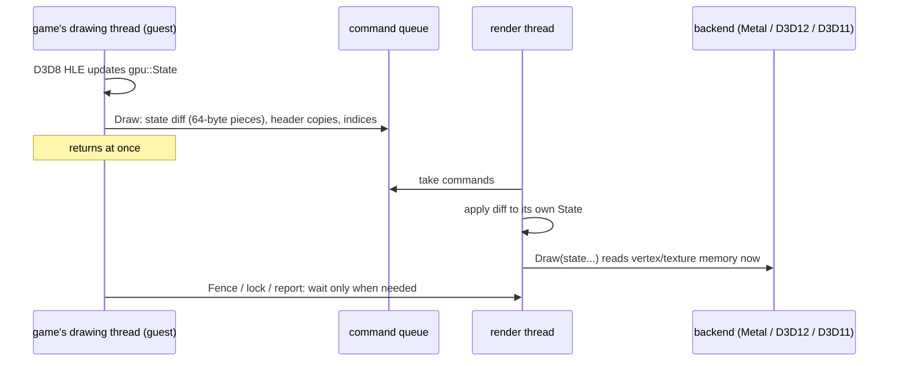

# Part 3: the GPU side

How the game's Direct3D 8 calls become pictures: the state model, the render thread, vertex assembly, shader
generation (fixed function, NV2A vertex programs and register combiners to HLSL), render targets and scaling, the CPU
reference renderer, and the Direct3D backends. Part 4 covers the Metal backend in detail.

Sources read: `sdk/runtime/gpu/{backend.h,state.h,ext.h,render_thread.cpp,shaders.{h,cpp},vertex.{h,cpp},d3d_common.h,
texture.h,interp.cpp}`, heads of `d3d12.cpp`/`d3d11.cpp`, `sdk/harness/reference_renderer.cpp`, `sdk/runtime/xdk/d3d8.cpp`,
`src/game/draw_filter.cpp`, `FINDINGS.md`.

## 3.1 Background: what the Xbox GPU was

The Xbox's GPU is NVIDIA's NV2A (roughly a GeForce 3). Games program it through the XDK's Direct3D 8, which writes
hardware commands to a push buffer. Its programmable parts differ from PC shaders:

- **Vertex programs**: NV2A microcode, 136 instruction slots, 192 constant registers (`c[-96..95]` in D3D terms), a MAC
  unit (`mov mul add mad dp3 dph dp4 dst min max slt sge arl`) and an ILU (`rcp rcc rsq exp log lit`) per instruction.
- **Pixel shading**: four texture stages (with modes such as projective, cube, dot product, bump environment map)
  followed by eight **register combiner** stages and a final combiner, described by a `D3DPIXELSHADERDEF`.
- **Fixed function**: Direct3D 8's transform, lighting and texture stage operations, used when no programs are set.
- Console-specific features the runtime must copy: W-buffered depth, point sprites, visibility tests, swizzled and
  compressed textures, 16 and 24-bit depth formats readable as colour.

None of this is emulated at the hardware level. The runtime implements the *API*, then generates host shaders from
what the title set.

## 3.2 From D3D8 calls to `gpu::State`

`sdk/runtime/gpu/state.h` says it plainly: "Everything the title handed to the XDK Direct3D API, as the API defines it.
... nothing here models the console's GPU." `d3d8.cpp` (part 2) updates one `gpu::State`:

- `simple[]`: simple render states keyed by their push-buffer method (`kMPsRgbInputs`, `kMPsConstant0`...), so pushed
  commands and API calls land in the same table.
- `rs[]`: deferred and complex render states by D3DRS index (the XDK build's own numbering, `state_numbering.h`).
- `textures[4]`, `palettes[4]`, `tss[4][...]`: guest texture headers and stage states.
- Streams, `vs_handle` (an FVF, or a program when bit 0 is set), the vertex shader's declaration and program,
  `vsc[192]` (constants in hardware order), the pixel shader definition.
- Fixed function: `transforms[512]`, `lights[8]`, materials.
- Targets (`rt`, `zs` as `Surface`s: guest header, data address, format, size), viewport, scissors.
- Console behaviours: `zscale` and `inv_wfar` for W-buffering, `aa_x/aa_y` (multisample modes drawn smaller), the
  ultrawide fields (`hud_aspect`, `squeeze_shift`, `pillar_aspect`...).

`gpu::Backend` (`backend.h`) is the interface every renderer implements: `Init`, `Clear`, `Draw(state, prim, start,
count, indices)`, `Copy`, `Present`, `Sync`/`SyncLate` (the CPU is about to read a resource the GPU wrote), `Flush`,
`Kick`, `SetGamma`, visibility reports (`ClearReport`, `GetReport`) and fences.

## 3.3 The render thread (`gpu/render_thread.cpp`)

`CreateThreadedBackend(inner)` wraps the real backend. The game's thread records each call with what the console
captures at call time: state changes (only the 64-byte pieces of `State` that changed since the last command), copies
of resource headers (a 16 MB ring of header copies), index data and rects. Vertex, texture and surface *memory* is read
later, when the render thread draws, as the console's GPU reads it after the call returns. The XDK's fences, busy
checks and locks wait for the render thread when the title needs results.

Notes:

- **Header ring size.** PGR2 points one texture header at each material in turn. With the planar water pass drawing the
  city twice a frame, the 1 MB ring wrapped before the render thread read the copies: wrong textures and about 4 fps on
  Metal. It is 16 MB now (`kHeaderRing`; PROGRESS 2026-11-06).
- **Draw merging** (`GameInfo::merge_draws`, off for PGR2): runs of indexed triangle draws with identical state can
  join.
- **Baked AO lookups** happen on the game thread before the indices are copied, because the AO key uses the indices'
  guest address (part 4).
- `XBE_RENDER_THREAD=0` draws on the title's thread instead (A/B testing).

## 3.4 Draw filters: the game's say over single draws (`gpu::g_draw_filter`, `src/game/draw_filter.cpp`)

A title may install a filter that sees each draw's state on the render thread and returns a `DrawAdjust`: drop the
draw, drop its depth test, add depth bias, give stage 3 another texture (`stage3`), stencil-mark it, or attach ray
tracing data (`trace_*`, part 4). PGR2's filter:

- labels each draw's **pass** for the performance recorder (main, mirror, cube, car_cubes, light_pool, water, hud_2d,
  no_camera, other) by the camera being drawn;
- makes **car shadows** darken once (a stencil mark per frame on shadow draws only, `cpu_car_shadows`);
- swaps **reflection cubes** (other cars take the live cube or their own cube, `car_reflections.cpp`);
- marks water draws for the **planar reflection** (stage 3 becomes the mirrored target);
- removes draws the DLC data breaks (PGR2's magenta error material, garbage strides);
- feeds the **ray traced scene** and **baked AO** eligibility.

Filters run away from the guest call that made the draw, so they must match the draw itself (texture modes, shaders,
vertex positions), not the routine around it (FINDINGS.md).

## 3.5 Vertex assembly (`gpu/vertex.{h,cpp}`)

`Assemble` turns a draw's streams and declaration (or FVF) into what a host input assembler takes:

- **Raw path**: the guest's own vertex bytes are handed to the GPU with a host format per element (DXGI format numbers,
  also used by Metal through `runtime/mac/compat`). Elements the host cannot read directly are finished in the vertex
  shader by a 4-bit `VertexDecode` code: `SHORT` to float, `NORMPACKED3` (11:11:10 signed), 3-component to 4 with w = 1.
- **Converted path**: each vertex converted to float4 on the CPU when the raw path cannot be used.
- Strips and fans: fans, quads and line loops are rebuilt as index lists; strips stay strips.
- Sparse indices: vertices gathered in draw order when the indices reference a small part of a large buffer.
- A declaration that reads past the stride reads the next vertex's bytes, as the console does.
- A draw whose vertices lie outside committed guest memory is left out and logged (Paris DLC garbage strides).
- On arm64, index range scans use NEON (PROGRESS 2026-11-08).

## 3.6 Shader translation (`gpu/shaders.{h,cpp}`)

Shaders are generated as **HLSL source text** from keys, compiled by D3DCompile on Windows, or translated to Metal
Shading Language by `msl.cpp` on the Mac (part 4). One constant buffer (`DrawConstants`, `b1`) is shared by both
stages: target size, fog, alpha reference, combiner constants (`pc[18]`), bump matrices, fixed function matrices,
lights, the W-buffer parameters (`wdepth`), the ultrawide squeeze (`hud`) and the wide-tap parameters (`spread`).

### Vertex programs: `VertexProgramHlsl(prog, regs, decode)`

Each NV2A instruction (4 dwords) is decoded into its MAC and ILU operations, sources with swizzles and negation,
destination masks and the address register, and written as HLSL statements. Helpers reproduce NV2A arithmetic: `rcp`
with magnitude clamping, `exp`/`log` returning their three parts, `lit` with the power clamp. `oPos`, colours, fog,
point size (`oPts`) and texture coordinates go to the vertex output. The program is cached by its bytes, the input
registers present and the decode codes. Two classifiers help ultrawide: `ScreenProgram` (a pass-through program that
only moves positions to the screen) and `MatrixProgram` (a program whose first four `dp4`s use an orthographic matrix)
identify 2D.

### Fixed function: `FixedVertexHlsl` and the stage combiners

`MakeFixedKey` collects what the fixed pipeline does (lighting flags, material sources, light types, texture coordinate
generation, transform flags, vertex blending) and `FixedVertexHlsl` writes Direct3D 8's transform and lighting in view
space. Texture stage operations (`D3DTOP_*` with `D3DTA_*` arguments) are written as pixel shader code (`FfOp`,
`FfArg`).

### Register combiners: `PixelHlsl(PixelKey)`

`MakePixelKey` captures the `D3DPIXELSHADERDEF` combiner words (or the fixed stages), texture modes per stage, alpha
kill, projective stages, W-buffering, alpha-to-coverage, a quad flag and baked AO. `PixelHlsl` writes:

1. **Texture stages** (`TexFetch`) per mode: 2D, cube, projective, dot-product stages, bump environment mapping, depth
   textures as shadow comparisons, depth buffers read as colour bytes (`depthbytes`, the console's D24S8 word; PGR2's
   replay depth of field needs it), `kTexWide` (an upscaled target sampled by a pass that shrinks it: each tap averaged
   over a console texel, capped at 5 taps a side since 2026-11-08), `kTexOpaque`, and `planar` (mode 0xC with a 2D stage
   3, which no console draw can have: the planar water reflection read at the pixel's screen position, bent by the
   normal map).
2. **Combiner stages**: each stage's four inputs with their mappings (unsigned, expand, signed, invert...), RGB and
   alpha portions, dot products, mux, scale and bias outputs, then the **final combiner** (`A*B + (1-A)*C + D`, `E*F`,
   `G`).
3. Fog, the alpha test (or coverage under MSAA), output saturation.

### Points and lines

Xbox point sprites (PGR2's trees) cover their console pixel size (`oPts` 2 to 64): on D3D a geometry shader expands a
point to a quad; on Metal an instanced quad (`vpoint`). Lines are one console pixel wide via a geometry shader on D3D
(added 2026-11-06 after the Mac port; whether Metal draws them the same way was not checked).

## 3.7 Depth: console-accurate W-buffering

PGR2 uses `D3DZB_USEW` on nearly every draw. Depth is the pixel's own w, perspective-correct, plus the polygon offset
in w units, in the guest depth format's steps. The pixel shader writes it (`wdepth` constants). Fixed function and
pre-transformed vertices have w scaled by `zscale * inv_wfar` as the XDK folds it in (`SetTransform` is on the host,
so the runtime computes this itself). W-buffered draws are not clipped at the far plane (z clamped within w), which
fixed the Nurburgring sky. A depth buffer larger than the colour target serves it from its top-left corner (the
showroom car). FINDINGS.md, "Rendering: console behaviours", has each case and its evidence.

## 3.8 Render targets and scaling

- **Targets are found by guest data address.** Each console surface drawn into gets a host texture ("target") keyed
  by its data address, depth flag and size. Textures whose data address is a target's sample the target itself.
- **Render scale.** Targets are made at the console size times the render scale (`app::RenderScale`); 2D and screen
  quads are scaled to match. Small targets (cube faces, shadow maps, the 256x256 light pool) scale too, except a pair
  the game names smaller (`g_small_target`, the water reflection at 50-100%).
- **Ultrawide and aspect**: screen-shaped targets get more pixels across; 2D that does not span the frame is squeezed
  into a centred 16:9 or 4:3 part (`HudSqueeze`, `DrawSpan` rules), the game widens its 3D views through
  `src/game/hooks.cpp`. 16:10 screens run the console's 4:3 mode widened to 1.6 (`fills_narrow_screens`); PGR2's
  menus are shown at 4:3 with bars (`app::g_frame_aspect_cap`), its title 2D over the wide attract demo at 4:3
  (`State::hud_aspect`) (PROGRESS 2026-11-09).
- **Read-backs.** When the CPU locks a surface the GPU wrote (`Sync`), its pixels are copied back to guest memory
  (32-bit linear and swizzled surfaces); `SyncLate` (NOOVERWRITE locks) delivers the newest finished copy without
  waiting, as the console gives a frame-old result.
- **Cube faces** drawn on the GPU (`SetRenderTargetFast`) replace their cube's level 0 once a frame.
- **MSAA**: big colour targets and their depth draw into multisampled "twins", resolved into the normal target before
  anything reads it, so readers never see multisampled textures.
- **Sharp 2D** (`Sharpen2D`, `upscale.cpp`): textures used by 2D draws are enlarged sharp on a background thread. Since
  2026-11-09 a faint or clear texel reads no more than itself at its centre, which removed bright lines beside the
  tachometer numerals.
- **Final passes**: gamma ramp, FXAA, SMAA (D3D only), sharpening, the scaling filter, then the ImGui overlay.

## 3.9 The CPU reference renderer (`sdk/harness/reference_renderer.cpp`)

A software rasteriser used only by the headless harness. It evaluates surfaces, textures, vertex programs, combiners
and fixed function stages from the XDK's definitions, decoded the way `shaders.cpp` decodes them, and writes pictures
to guest memory and TGA files (`REF=N`, `snap`). It has diagnostic modes the GPU backends lack: per-draw logs of
pixels and stencil written (`REF_DRAWLOG`), who owned a failing depth test (`REF_ZOWNER`), colour probes at pixels
(`PROBES`, `TRACE`), level surfaces (`REF_FLAT`, how the water was found), every target of a frame (`REF_TARGETS`,
added by the Mac work). It is written separately from the GPU backends on purpose: a fault in both points to shared
state handling, a fault in one to that renderer (FINDINGS.md, "Lessons on working").

## 3.10 The Direct3D backends (Windows, high level)

- **Direct3D 12** (`gpu/d3d12.cpp`, about 3,900 lines): the original renderer. Pipeline state objects keyed by a hash
  of `PsoKey` (shaders, input layout, blend, depth, raster, target formats, samples), cached across runs
  (`shadercache.bin`, `pipelinecache.bin`); descriptor tables and root arguments reused when unchanged; MSAA twins;
  renderer extensions (`gpu/ext.h`); F3 captures; a cube-face shrink pool (2026-11-07).
- **Direct3D 11** (`gpu/d3d11.cpp`, about 2,200 lines): added 2026-10-21 for GPUs where D3D12 runs badly; the console
  path of `d3d12.cpp` with API-independent parts shared through `gpu/d3d_common.{h,cpp}`. The Metal backend follows
  this one.
- **`gpu/d3d_common`** holds what all three share: console values to host enums, sampler descriptions, pipeline and
  shader keys, `DrawConstants` filling, guest rect lists, the squeeze rules, `GuestPitch`, surface signatures.
- **`gpu/interp.cpp`**: in-between frames for titles that draw one frame per game step (`step_interpolation`); not used
  by PGR2.
