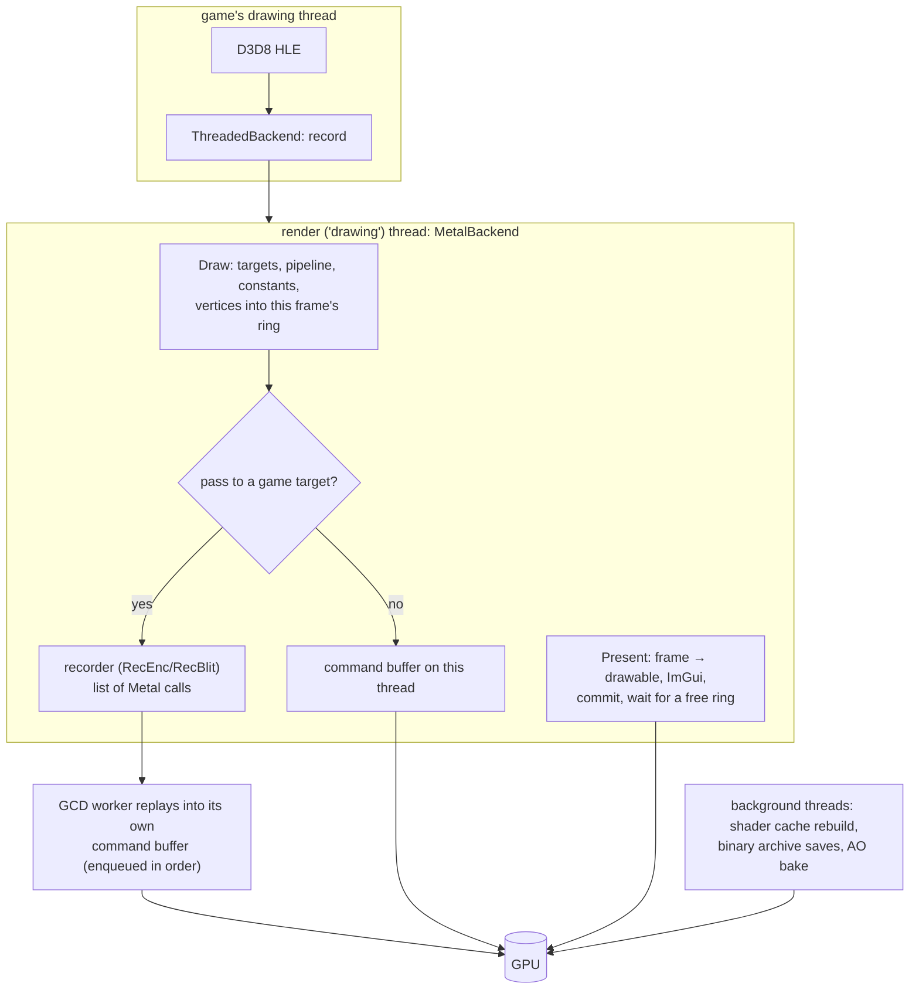

# Part 4: how Metal is used

The macOS renderer: `sdk/runtime/gpu/metal.mm` (about 3,300 lines, `MetalBackend`, a `gpu::Backend`), the HLSL to Metal
Shading Language translator `sdk/runtime/gpu/msl.cpp`, baked ambient occlusion `sdk/runtime/gpu/baked_ao.{h,mm}`, and the
performance recorder `sdk/runtime/app/perf.{h,cpp}` with `sdk/tools/perf/analyze.py`. The backend follows
`d3d11.cpp`'s structure and reuses everything API-independent through `gpu/d3d_common` (the Win32 and D3D12 names
it needs come from `sdk/runtime/mac/compat/`).

All of this was written for the macOS port (SDK commits from `c984837`, 2026-11-05, to `44c0b8a`, 2026-11-10).

## 4.1 The big picture

## 4.2 Device, layer and fixed objects (`MetalBackend::Init`)

- The `CAMetalLayer` comes from SDL's Metal view (`app::MetalLayer()`); the device is the layer's or the system
  default. Layer format `BGRA8Unorm`, `framebufferOnly = NO`, `maximumDrawableCount = 3`.
- One command queue. Four per-frame **rings** (`kFramesInFlight = 4`, 96 MB each, shared storage, write-combined CPU
  cache) and a semaphore with three permits (section 4.6).
- A visibility result buffer of 65,536 eight-byte counters (`kVisSlots`).
- Pass samplers (linear and point), depth-stencil states, a 256x1 gamma lookup texture, and zero "dummy" textures for
  unbound stages (2D, 3D, cube, depth).
- Formats: colour targets `BGRA8Unorm`, depth `Depth32Float_Stencil8` (Metal has no D24S8 on Apple GPUs; depth bias is
  therefore only approximate, MACOS.md "Renderer gaps").
- `trace_ok_ = supportsRaytracing && supportsRaytracingFromRender` decides whether ray traced reflections can run.
- `OpenCache()` loads the shader cache (section 4.4).

## 4.3 HLSL to MSL (`gpu/msl.cpp`)

The shader generators (`gpu/shaders.cpp`, part 3) write HLSL. Rather than a second generator, `msl.cpp` translates
that HLSL **by text**, relying on it being a small, known subset ("HLSL to MSL by text: the generators' HLSL is a
small, known subset", file header). The approach:

- MSL is C++, so the source stays almost as written, **inside one `struct Shader`**: `cbuffer`s become its fields,
  helper functions and the entry point become member functions. Inside the struct, functions see the constants as
  HLSL globals, unchanged.
- `FixKnown` applies a fixed list of rewrites: types (`Texture2D` → `Tex2D`, `TextureCube` → `TexCube`, wrapper types
  in the prelude that offer HLSL-like `Sample`, `SampleCmpLevelZero`, `Dim()`), intrinsics (`ddx`/`ddy` → `dfdx`/`dfdy`,
  `discard` → `discard_fragment()`, `clamp` → `hclamp`), scalar swizzles (`dot(a,b).xxxx` → `float4(dot(a,b))`, since MSL
  scalars have no swizzles), `1.#INF` → `INFINITY`, ternaries on vectors → `select`, removal of `precise` and
  `static`.
- Semantics on struct fields become attributes (`SV_Position` → `[[position]]`, inputs → `[[attribute(n)]]`; others
  matched by name between stages). Texture coordinates are interpolated at a covered sample (centroid) so MSAA edges
  do not read past a quad (2026-11-09).
- Entry points are wrapped as free functions: `vertex Shader::VOut vmain(VIn i [[stage_in]], uint vid [[vertex_id]],
  constant Shader& S [[buffer(0)]]) { return S.main(i); }`. Constants are one block at buffer 0 (vertex constants
  then draw constants). `vpoint` is the same vertex shader expanded to a quad per instance for point sprites (Metal has
  no geometry shaders). Pixel shaders become `fmain` with textures and samplers as arguments.
- Special globals get extra arguments: `TexTrace` (the acceleration structure at buffer 1, per-triangle shading at
  buffer 2, a 16-texture array from texture slot 8) for traced reflections, and `TexAo` (triangle and value buffers at 3
  and 4) for baked AO, with `[[primitive_id]]` and `[[barycentric_coord]]` passed in.
- `PassMsl` translates the full-screen passes (blit, depth copy and resolve).
- `tools/mslcheck` compiles a folder of shaders dumped by the harness (`AUDIT=N`) through the translator, so the
  translation can be checked without the game.

Compile options (`ShaderOptions`): `mathMode = MTLMathModeSafe` (no assumptions about NaN or infinity, no reordering,
as the console) and `preserveInvariance = YES` (passes with an EQUAL depth test need bit-identical positions).

## 4.4 Pipelines and the shader cache (`metalcache/`)

- A draw's shaders are found by key (vertex program bytes or fixed function key, plus pixel key); the MSL is compiled
  with `newLibraryWithSource` the first time. A pipeline state object is made per `PsoKey` (shaders, vertex layout
  and strides, blend, write mask, target formats and sample count). Culling, depth bias, fill mode, depth and stencil
  state are set per draw on the encoder, so a new polygon offset or render scale never makes a new pipeline.
- **The cache across runs.** Every shader and pipeline a run needs is appended to `metalcache/records.bin` beside the
  executable. At the next start, `Precompile` rebuilds them on background threads spread over most cores (a game
  thread may be asking for the same shaders meanwhile; finished ones are handed to the render thread by `TakeReady`).
  Built pipelines are also added to a **Metal binary archive** (`metalcache/pipelines.bin`, saved at most every 30
  seconds on its own queue, and when the window closes), so their machine code is not made again.
- Records are stamped with `kShaderSourceHash`, a CMake hash of the shader generator sources (part 1); records from
  other generator code are dropped, so changing `shaders.cpp` or `msl.cpp` means a full recompile on the next run (the
  "hitches" seen after such changes, PROGRESS 2026-11-09). `XBE_NO_SHADER_CACHE=1` turns it off.
- Any frame over 50 ms logs a `hitch:` line with its shader, pipeline, upload and read-back costs.
- Caveat (MACOS.md): records hold Metal source derived from the game's shaders and archives are GPU- and OS-specific,
  so neither can be shipped.

## 4.5 Command buffers, encoders and parallel encoding

- **One open encoder at a time.** `OpenPass(colour, depth, resolve...)` reuses the open render encoder when the targets
  are the same, else ends it and opens a new one with load/store actions (load, store; resolve when MSAA). Redundant
  binds are skipped: textures and samplers the encoder already has (18,000 to 3,800 texture binds a frame,
  2026-11-08), pipeline, depth state, viewport and scissor.
- `Cb()` returns the current command buffer; `Commit()` ends the encoder, stamps visibility queries with the buffer's
  serial, adds a completion handler (delivers finished reports, records GPU busy time without counting overlapping
  buffers twice) and commits.
- **Parallel encoding** (2026-11-08/09). While a run of passes to the game's own targets is being made, a recorder
  (`RecEnc`, `RecBlit`, Objective-C objects that answer the encoder selectors) stands in for the real encoders: the
  drawing thread does all of a draw's work as before, but the Metal calls go into a list. `StartRun` commits what came
  before and creates and **enqueues** a command buffer, fixing its place in the GPU's order. `EndRun` hands the list to
  a concurrent GCD queue, where a worker replays it into that command buffer and commits. Anything that needs order
  settled (a visibility-tested draw, a read-back, the present) ends the run. Switches: `XBE_NO_PARALLEL=1` (off),
  `XBE_PARALLEL_SMALL=1` (only the square reflection cube faces). Measured: drawing thread 21.0 to 19.0 ms on a locked
  Hong Kong demo with constants and geometry cheaper too (PROGRESS 2026-11-09).
- **Constants.** One block per draw in the ring: vertex constants then draw constants, uploaded only when something
  read from it changed. Comparison is against a cached CPU copy, because reading back the write-combined ring cost more
  than the copy saved; only fixed-function draws compare and write the large matrix and light range (`wv` to `lt`).
- **Vertices and indices** are copied into the frame's ring each draw (`DrawGeometry`), then bound at buffer
  `kVertexBufferBase + i`.

## 4.6 Per-frame rings and frames in flight

Each frame writes vertices, indices, constants and uploads into its own 96 MB ring (a bigger one is made if it fills).
`Present` adds a completion handler that signals the frames semaphore, commits, then **waits** on the semaphore before
moving to the next ring. The semaphore starts with `kFramesInFlight - 1 = 3` permits for 4 rings, so at most three
frames are queued and the ring the next frame writes is never one the GPU is still reading.

This is the **frame-buffer ring fix** (SDK `6e23d6b`, 2026-11-09): there used to be three rings and three permits taken
after each commit, so a fourth frame could overwrite the first frame's ring while the GPU still drew it. Under GPU load
(MSAA 4x at 2560x1600) that showed as coloured blocks in the rear-view mirror and a flickering HUD (the mirror being
drawn from the next frame's vertices and constants). A first fix with two queued frames cost frame time; four rings
with three queued restored pacing. `XBE_FRAMES_AHEAD=1..3` tests fewer.

## 4.7 Targets, MSAA twins and resolves

- A **target** (`Target`) is a host texture for a console surface, keyed by guest data address, depth flag and (for a
  smaller depth surface) size. Size is console size times the render scale. Colour targets are `BGRA8Unorm`, depth
  `Depth32Float_Stencil8`.
- A smaller colour target drawn with a bigger depth buffer uses the depth buffer's top-left part (a stand-in depth
  target of its size). A colour target on the depth buffer's own memory binds the depth alone.
- A draw that samples the target it renders to gets a copy (the console reads the pixels it is about to overwrite).
- Upscaled targets read by a pass that shrinks them use wide taps (part 3); cube faces drawn on the GPU replace their
  cube's level 0 once a frame.
- **Render scale changes** wait until the new scale has held for half a second (window dragging), then remake targets;
  colour targets keep their pictures, scaled (PGR2 draws its mini map once and samples it for long after).
- **MSAA** (2026-11-09, the existing `msaa` setting: 2x, 4x, 8x). Eligible targets are those as big as the console's
  screen and their depth (`MsEligible`; not the water reflection or the cubes). Each gets a multisampled twin
  (`EnsureMs`) that draws go to; each pass ends by resolving into the normal target
  (`MTLStoreActionStoreAndMultisampleResolve`; depth and stencil take sample 0, as `d3d11.cpp` does), so every reader
  still sees a plain texture. When something other than the twin writes the target, `RefreshMs` copies its pixels
  into the twin. A change of MSAA level drops all twins. Smooth alpha edges (alpha to coverage) works with it.

## 4.8 Presentation and sizing (`MetalBackend::Present`)

1. The front buffer's target is found; CPU-written pixels are uploaded; the gamma LUT is refreshed if the ramp
   changed.
2. The layer's `drawableSize` is set to `app::DrawablePixels()`; `displaySyncEnabled` follows the vsync setting.
3. `nextDrawable` (its wait is timed for the recorder).
4. A render pass on the drawable clears to black, sets a viewport that places the frame **at its own target's
   shape**, centred (so a frame drawn before a change of shape is not stretched), and blits it with gamma (`Blit`,
   `final`). The sizes along the way (layer, drawable, frame, where shown) are logged when they change.
5. F12 screenshots read the drawable back before the interface is drawn; ImGui (F1 window, FPS counter) is drawn on
   top; `presentDrawable`.
6. Commit, wait for a free ring (4.6), then `BuildScene` (ray tracing, 4.12), `DeliverReports`, perf rows, hitch
   lines, `TakeReady` (shader cache), texture sweep, `ApplySettings` (MSAA, scale).

Sizing rules that matter on a Mac: the backing size of a Retina window is what is rendered (5120x3200 on a display
that "looks like" 2560x1600), so `app::RenderScale` divides by the pixel density: 100% now means the screen's size in
points, 200% every backing pixel; and the height is the visible picture's (a 16:9 frame in a 16:10 window was rendered
23% too large). The window opens at the screen's shape so the game latches the right TV shape at boot (16:10 runs the
4:3 mode widened to 1.6). PROGRESS 2026-11-09 has the numbers.

## 4.9 Samplers

Samplers are built from the same D3D sampler description the Windows backends use (`d3d_common`): filters,
anisotropy, address modes, comparison. Two Metal-specific limits:

- **LOD bias**: `MTLSamplerDescriptor.lodBias` exists only on macOS 26 and later; earlier versions log once that it is
  left out (2026-11-07). PGR2 uses -1 (city), -2 (menus) and -3 (cars).
- **Border colours**: Metal offers transparent black, opaque black and opaque white; the nearest is taken. PGR2's ground
  shadows use white with no alpha, which maps to opaque white (black drew a line along the mesh's edge).

## 4.10 Read-backs

- `Sync` (the CPU reads a surface the GPU drew): the target is blitted to a shared buffer, the command buffer committed
  and waited for (`waitUntilCompleted`), and rows written into guest memory (BGRA, packed). Costs are counted per frame.
- `DeliverLate`/`RecordLate` (NOOVERWRITE locks): up to three copies in flight per surface (`kLateSlots`); the newest
  finished one is written back without waiting, as the console gives a frame or two old result.
- After a `Sync`, every byte is compared on the next upload so only pixels the CPU actually changed go back over the
  picture, which stays at render scale.

## 4.11 Visibility queries

The console's visibility tests (PGR2: a light glow's brightness comes from an occlusion probe) map to Metal's
visibility result buffer: a counting draw sets `MTLVisibilityResultModeCounting` at its slot's offset, then disables
it. A report is written into guest memory "as the console's GPU writes them" (time, count, then 0 for done) once the
command buffer holding its draws completes.

- 2026-11-06: `Flush` waited only for a buffer it had committed itself, so a report on an earlier buffer stayed pending;
  at a race's end PGR2 polls about 4,000 light tests without presenting and froze. `Flush` now waits for the newest
  committed buffer (SDK `7a53864`).
- 2026-11-08: when the title asks for a report without waiting (`Kick`), the drawing thread commits and goes on; each
  command buffer's completion delivers its reports under a lock. Slow frames fell from about 27-39% to 9-10% in the
  demos test. `XBE_REPORTS_BLOCK=1` restores the wait. PGR2's post-race screens garbled without the wait, so
  `src/game/hooks.cpp` sets `gpu::g_reports_wait` on those screens.

## 4.12 Ray traced car reflections (`traced_reflections`, off by default, macOS only)

The console gives the followed car a live reflection cube and other cars the city's fixed cube; no car ever reflects
another. The PC work added cars to the cube and a cube per car (`src/game/car_reflections.cpp`, part 5). On top of
that, ray tracing lets a car's paint reflect the neighbouring cars themselves:

1. **Scene gathering.** `PGR2`'s draw filter marks car draws with `DrawAdjust::trace_scene` and a world matrix. Each
   such draw's triangles (input register 0, transformed to the world) join the frame's scene with per-triangle shading
   data (`kTraceWords`: three half-precision texture coordinates, packed normals, lit vertex colours, a material word
   holding the texture index, a glass flag and the object id). A car's meshes are read once and kept (`trace_mesh`)
   while drawn; unused ones are dropped after ten seconds.
2. **Objects and boxes.** At `Present`, `BuildScene` groups draws into objects (largest first; a draw joins the first
   object whose bounds, 30 cm wider, hold its centre), writes each object's bounding box after the triangles, copies
   positions and shading into the slot of the frame drawn next, and builds a **primitive acceleration structure**
   (`MTLPrimitiveAccelerationStructureDescriptor`, one opaque triangle geometry, `PreferFastBuild`) with an
   acceleration structure command encoder. The next frame traces against it, so the scene is one frame old; each
   pixel is carried into it by its own car's move since.
3. **Tracing in the fragment shader.** Car paint and glass draws get `kTexTraced` in their pixel key. `traced()` in
   `gpu/shaders.cpp` (bound by `setFragmentAccelerationStructure` at buffer 1) reconstructs the pixel's place in the
   scene from its console pixel and w (`trace_from`), turns the cube direction into the scene's frame, computes the
   surface facing from screen derivatives, and fires a `raytracing::intersector<triangle_data>` ray with back-face
   culling chosen per winding. Its own car is passed through (its low-poly body seen in itself looked wrong). A hit is
   shaded as the hit car is drawn (its texture from the 16-texture array, its lit colour, the cube reflected there),
   faded out toward the longest ray; a miss reads the cube.
4. **Cost.** First version: rays near a car's own dense triangles were slow. Since 2026-11-10 (SDK `44c0b8a`) a ray
   first tests the other cars' boxes: a ray meeting none returns the cube at once (most rays: sky, road, buildings),
   one that does searches only between the first box it enters and the last it leaves. Hong Kong demo, MSAA 4x,
   2560x1600: GPU 42 ms a frame traced before, 18 ms after, 12.5 ms untraced.
5. **Coordinates** (learned 2026-11-08): the followed car is drawn in a world centred on the eye and turned with the
   camera (c122-c124), other cars in the city's frame (c110-c112), so every draw is taken into the camera's frame with
   the rotation read off the projection. TV cameras in demos sit 90-130 m from the pack, so the car range is 400 m
   (`traced_range`), the longest ray 60 m (`traced_ray`).
6. **Debugging**: `XBE_TRACE_DEBUG=1..6` (hits, distance, shaded hit, texture, chrome mirror, alignment check),
   `XBE_TRACE_LOG=frame`, `XBE_TRACE_NORAY`, `XBE_TRACE_NOBOX`, `XBE_DUMP_CUBES=frame`.

## 4.13 Baked ambient occlusion (`gpu/baked_ao.{h,mm}`, `src/game/baked_ao.cpp`)

Setting `baked_ao` (percent of the baked occlusion, 60 by default, 0 off; F1 > Picture "Ambient Occlusion"). The
city's static meshes are ray traced for ambient occlusion in the background and stored per city in
`metalcache/ao/scene_<city>.bin`; nothing is shipped or waited for, so a street has none the first time it is seen.

- **Which draws.** The game says (`ao::g_eligible`): the city programs' draws, not water or blended, with the city's
  index as the scene (`ao::g_scene`). Their vertices are in world coordinates and never change, so each is known by its
  vertex data, its indices' guest address and count, read on the game thread before the render thread copies the
  indices (`ao::Lookup`, carried with the draw command as `ao::g_draw`).
- **The bake** (a Metal compute kernel `bake` in `baked_ao.mm`). New triangles go into the scene; at 20,000 new
  triangles or 3 seconds a background thread builds an acceleration structure of all the scene's triangles and bakes
  the new ones: a grid of points on each triangle (one every 25 cm along its longest edge, at most 16), 128
  cosine-weighted rays 8 m long per point, in command buffers of about a millisecond (`kRaysPerBuffer`). Each
  triangle is baked on the side the camera was on when its mesh was first drawn (the city is wound either way and
  every face on screen reports front facing, so neither tells which side is seen). Hits on surfaces within about 18
  degrees of parallel and 25 cm of the point's plane are ignored (roads are laid in overlapping layers).
- **The read.** Pixel shaders of those draws (`PixelKey::ao`) take `[[primitive_id]]` and `[[barycentric_coord]]`,
  find the triangle's grid in the value buffer, interpolate the three grid points around the pixel, and multiply the
  colour before fog. Apple GPUs give a strip's odd triangles their barycentrics in the bake's order (swapping them drew
  diagonal seams; `XBE_AO_FLIP=1` shows it). `XBE_AO_DEBUG=1` shows the occlusion alone.
- **Re-bakes.** A later run re-bakes what was baked against fewer than four fifths of the triangles the scene has since
  shown, and rewrites the file once half of it is superseded. Files are 25-80 MB per city. Cost in the demos: 59.8
  fps with AO off and from the cache, 59.6 while baking (PROGRESS 2026-11-09).

## 4.14 The performance recorder (`app/perf.{h,cpp}`, `tools/perf/analyze.py`)

F9 starts and stops a recording (or `XBE_PERF=1` from the start); F10 drops a marker. Each recording is a folder
`perf/<date-time>` beside the executable:

- `frames.csv`: one row a frame: interval and fps, work time without display waits, waits (pacer, `nextDrawable`,
  frames in flight), GPU time from command buffer start/end (overlaps not double counted), CPU time in draws by stage
  (read from the ARM cycle counter), shader/pipeline/upload/read-back costs, report and kernel waits, draws and
  triangles by pass and kind, per-pass vertex and fragment GPU time from Metal counter-sample timestamps at stage
  boundaries, the city, replay flag, view mode, cars, the game's own function timings (`src/game/perf_zones.h`), the
  core each main thread ran on, memory, live textures, ring use and thermal state.
- `encoders.csv`: every encoder of one frame in ten (kind, pass, target size and format, load/store actions, draws,
  first draw's shaders and texture, vertex and fragment time); one frame in 120 gives each screen-space draw its own
  encoder so its cost shows alone.
- `threads.csv` (each thread's CPU time per frame), `events.csv`, `info.txt`, a copy of the settings.

`python3 sdk/tools/perf/analyze.py build/macapp/perf` turns the newest recording into `report.html`: what limited the
frames (GPU, drawing thread, another thread, the pacer, one-off costs; a frame counts as limited by whatever was busy
80% of its interval), timing over time with markers, threads, draws by pass, worst frames.

## 4.15 Known gaps (MACOS.md, PROGRESS.md)

- SMAA is ignored (logged once); MSAA does not cover the water reflection or cubes.
- LOD bias needs macOS 26; border colours snap to Metal's three; depth bias approximate on `Depth32Float_Stencil8`.
- No renderer extensions (`gpu/ext.h` is D3D12's) and no F3 captures on Metal.
- Lines drawn one console pixel wide on D3D (2026-11-06) were not checked on Metal.
- Open visual issue: a one-pixel bright line beside each tachometer numeral with MSAA on (PROGRESS 2026-11-09).
- Parallel encoding and the multi-pass changes changed a handful of pixels by at most 2/255 against the old path, cause
  not known.
